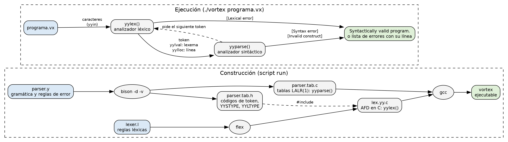
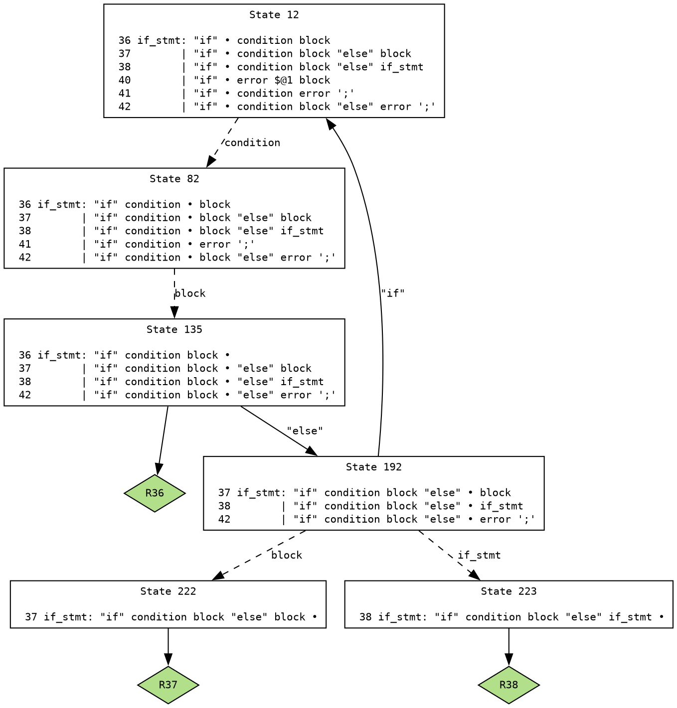
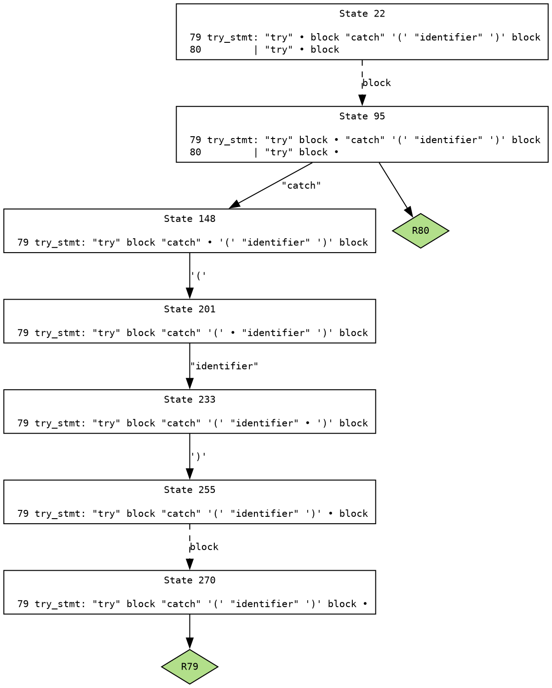

# Arquitectura del analizador de Vortex

Vortex (`.vx`) es un lenguaje para scripts científicos. Este documento describe cómo está construido su analizador léxico y sintáctico, qué decisiones de diseño se tomaron para eliminar las ambigüedades de la gramática y cómo se verifican los resultados. El analizador valida la estructura de un programa; no lo ejecuta.

## 1. Visión general

El analizador se compone de dos módulos escritos por separado y enlazados en un único ejecutable, `vortex`:

| Módulo | Archivo fuente | Herramienta | Modelo formal | Responsabilidad |
|---|---|---|---|---|
| Analizador léxico | `lexer.l` | Flex 2.6.4 | Autómata finito determinista | Agrupar los caracteres en tokens y reportar los errores léxicos |
| Analizador sintáctico | `parser.y` | Bison 3.8.2 | Autómata de pila LALR(1) | Validar que la secuencia de tokens cumple la gramática y reportar los errores sintácticos |

La Figura 1 muestra las dos etapas del sistema: la construcción del ejecutable y su ejecución sobre un programa.



*Figura 1: Construcción y ejecución del analizador.*

### 1.1 Construcción

El script `run` ejecuta cuatro pasos:

```
bison -d -v --graph=parser.dot parser.y
flex lexer.l
gcc -o vortex lex.yy.c parser.tab.c
gcc -DLEXER_ONLY -o vortex_lexer lex.yy.c
```

1. Bison lee `parser.y` y genera `parser.tab.c` (las tablas del autómata LALR(1) y la función `yyparse`), `parser.tab.h` (los códigos de token y los tipos `YYSTYPE` y `YYLTYPE`), `parser.output` (la descripción de los 279 estados del autómata) y `parser.dot` (el mismo autómata como grafo).
2. Flex lee `lexer.l` y genera `lex.yy.c`, que contiene el autómata finito en forma de tablas y la función `yylex`.
3. GCC compila y enlaza ambos archivos en `vortex`.
4. GCC compila el analizador léxico por sí solo en `vortex_lexer` (sección 2.2).

Bison debe ejecutarse antes de compilar el analizador léxico, porque `lex.yy.c` incluye `parser.tab.h`.

### 1.2 Ejecución

`main`, definido en `parser.y`, abre el archivo recibido como argumento, lo asigna a `yyin` y llama a `yyparse`. A partir de ahí el control lo tiene el analizador sintáctico: cada vez que necesita un token llama a `yylex`, que consume caracteres hasta reconocer el siguiente lexema y devuelve su código. El análisis termina cuando `yylex` devuelve 0 (fin de archivo).

Al finalizar se imprime `Syntactically valid program.` si no hubo errores, o `N error(s) found.` en caso contrario. El código de salida del proceso es 0 o 1, respectivamente.

## 2. Interfaz entre el analizador léxico y el sintáctico

Los dos módulos se comunican por cuatro elementos, todos declarados por Bison en `parser.tab.h`:

| Elemento | Dirección | Contenido |
|---|---|---|
| Valor de retorno de `yylex` | léxico → sintáctico | Código del token. Los operadores y delimitadores de un carácter se devuelven como el carácter mismo (`'+'`, `';'`); los demás tokens tienen un código propio (`T_INT`, `IF`, `EQ`, …) |
| `yylval` | léxico → sintáctico | Valor semántico del token. Solo se usa en `IDENTIFIER`, donde lleva una copia del lexema para que los mensajes de error puedan nombrar la variable o la función |
| `yylloc` | léxico → sintáctico | Línea del token. La macro `YY_USER_ACTION` la actualiza con `yylineno` antes de cada regla; el analizador sintáctico la consulta con `@n` |
| `num_errors` | compartido | Contador único de errores. Lo define `lexer.l`; `parser.y` suma los suyos |

### 2.1 Tokens diferenciados

Cada palabra reservada tiene una regla y un token propios. En particular, los siete tipos (`int`, `float`, `bool`, `string`, `void`, `vector`, `matrix`) producen siete tokens distintos, de modo que el tipo queda identificado desde la etapa léxica y la gramática puede exigir, por ejemplo, que `vector` vaya seguido de `<tipo básico>` o que `void` solo aparezca como tipo de retorno.

Las palabras reservadas se declaran antes que la regla `{ID}`. Cuando dos reglas reconocen un lexema de la misma longitud, Flex elige la primera; por eso `int` es un tipo y `integer` es un identificador (gana la coincidencia más larga).

### 2.2 Dos modos de compilación del analizador léxico

Las acciones de `lexer.l` usan la macro `TOKEN(categoría, código)`, cuya definición depende del modo:

| Modo | Cómo se activa | Efecto de `TOKEN` | `main` |
|---|---|---|---|
| Integrado | por defecto | `return código;` | el de `parser.y` |
| Solo léxico | `gcc -DLEXER_ONLY` | imprime línea, categoría y lexema | el de `lexer.l` |

Así un único archivo de reglas produce el analizador completo (`vortex`) y un programa que muestra la secuencia de tokens (`vortex_lexer`), útil para evidenciar la etapa léxica de forma aislada.

## 3. Estructura de la gramática

`parser.y` contiene 145 producciones organizadas en los siguientes bloques:

| Bloque | No terminales principales | Contenido |
|---|---|---|
| Programa y sentencias | `program`, `stmt_list`, `stmt`, `block` | Un programa es una lista de sentencias; un bloque es una lista de sentencias entre llaves |
| Tipos y declaraciones | `basic_type`, `type`, `var_decl` | `tipo nombre = expresión;` con inicialización obligatoria |
| Control de flujo | `condition`, `if_stmt`, `while_stmt`, `for_stmt`, `switch_stmt` | Todas las estructuras exigen `block` como cuerpo |
| Funciones | `func_def`, `param_list`, `param` | Tipo de retorno, parámetros con tipo y valor por defecto opcional |
| Excepciones y validación | `try_stmt`, `assert_stmt`, `jump_stmt` | `try`-`catch`, `throw`, `assert`, `return`, `break`, `continue` |
| Expresiones | `expr` … `primary` | Un no terminal por nivel de precedencia |
| Argumentos | `arg_list`, `arg` | Argumentos posicionales y nombrados |

Tres propiedades del lenguaje se obtienen directamente de la forma recursiva de la gramática:

- **Anidamiento y alcance léxico.** `block` es una alternativa de `stmt` y a la vez contiene una `stmt_list`. Por tanto los bloques se anidan sin límite y cualquier bloque admite declaraciones, incluidas las que repiten un identificador de un bloque externo (*variable shadowing*).
- **Funciones anidadas y recursión.** `func_def` es una alternativa de `stmt` y su cuerpo es un `block`, así que una función puede definirse dentro de otra. Una llamada (`IDENTIFIER '(' args ')'`) es una expresión válida en cualquier punto del cuerpo, incluida la llamada a la propia función.
- **Sobrecarga.** La convención adoptada es que dos funciones con el mismo nombre se distinguen por la cantidad y el tipo de sus parámetros. La gramática lo permite porque cada parámetro declara su tipo; comprobar que una llamada corresponde a una única versión es una verificación semántica, fuera del alcance de este analizador.

## 4. Resolución de ambigüedades y conflictos

La gramática final no tiene conflictos: Bison la procesa sin advertencias. Se llegó a ese resultado con tres técnicas.

### 4.1 Precedencia y asociatividad por estratificación

Una regla del tipo `expr: expr '+' expr | expr '*' expr` es ambigua: `a + b * c` admite dos árboles de derivación. En lugar de declarar la precedencia con `%left`, se reescribió la gramática con un no terminal por nivel, de modo que cada expresión tiene un único árbol:

| Nivel (de menor a mayor precedencia) | No terminal | Operadores |
|---|---|---|
| 1 | `or_expr` | `\|\|` |
| 2 | `and_expr` | `&&` |
| 3 | `eq_expr` | `==` `!=` |
| 4 | `rel_expr` | `<` `>` `<=` `>=` |
| 5 | `add_expr` | `+` `-` |
| 6 | `mul_expr` | `*` `/` `%` |
| 7 | `unary` | `-` `!` (prefijos) |
| 8 | `postfix` | indexación `[ ]` |
| 9 | `primary` | literales, identificadores, llamadas, reducciones, `( )`, `[ ]` |

Cada nivel se define en términos del siguiente (`add_expr: mul_expr | add_expr '+' mul_expr`). La recursión por la izquierda hace que los operadores binarios asocien a la izquierda: `a - b - c` se agrupa como `(a - b) - c`.

Esta forma tiene además un efecto sobre los mensajes de error. Al terminar una expresión, el autómata reduce nivel por nivel hasta la regla que la contiene, y el mensaje menciona solo lo que esa regla espera (`expecting ';'`), no la lista de todos los operadores posibles.

### 4.2 Factor común entre asignación y expresión

Las sentencias `v[0] = 9;` y `v[0];` comienzan con los mismos tokens. Con una regla separada para el lado izquierdo de la asignación, el autómata tendría que decidir entre dos reducciones antes de ver el `=`, lo que produce un conflicto reducir/reducir. Se resolvió leyendo ambos casos con el mismo prefijo:

```
simple_stmt: expr
           | expr '=' expr
```

El valor semántico de cada expresión es una bandera que indica si es asignable (un identificador, o una indexación sobre algo asignable). Si el lado izquierdo de un `=` no lo es, se reporta `invalid assignment target`.

La misma idea se aplica a los argumentos: `arg: expr | IDENTIFIER '=' expr`. La bandera de `arg_list` registra si ya apareció un argumento nombrado, lo que permite reportar un argumento posicional situado después de uno nombrado.

### 4.3 Conflictos desplazar/reducir de `else` y `catch`

Para dar mensajes específicos, la gramática acepta `else` y `catch` como inicio de sentencia (un `else` sin `if`, un `catch` sin `try`). Eso introduce dos conflictos. Al retirar las anotaciones `%prec` de `parser.y`, Bison los reporta así:

```
warning: 2 shift/reduce conflicts [-Wconflicts-sr]
warning: shift/reduce conflict on token "else" [-Wcounterexamples]
  Example: stmt_list "if" condition block • "else" block
  Shift derivation
    stmt_list
    ↳ 3: stmt_list stmt
                   ↳ 7: if_stmt
                        ↳ 37: "if" condition block • "else" block
  Reduce derivation
    stmt_list
    ↳ 3: stmt_list                                        stmt
         ↳ 3: stmt_list stmt                              ↳ 16: invalid_stmt
                        ↳ 7: if_stmt                            ↳ 90: "else" block
                             ↳ 36: "if" condition block •
warning: shift/reduce conflict on token "catch" [-Wcounterexamples]
  Example: stmt_list "try" block • "catch" '(' "identifier" ')' block
```

Después de `if (c) { }` con un `else` como siguiente token, el autómata puede desplazar el `else` (pertenece a ese `if`) o reducir el `if` y tratar el `else` como una sentencia huérfana. La Figura 2 muestra el estado donde ocurre: en el estado 135 coexisten la reducción R36 y la transición con `"else"`.



*Figura 2: Estados del autómata LALR(1) que reconocen la estructura if-else.*

Se resolvió con declaraciones de precedencia:

```
%nonassoc NO_ELSE
%nonassoc ELSE
%nonassoc NO_CATCH
%nonassoc CATCH
```

La regla sin `else` se marca con `%prec NO_ELSE` y la regla `try` sin `catch` con `%prec NO_CATCH`. Como `ELSE` y `CATCH` se declaran después, tienen mayor precedencia que esas reglas y Bison elige desplazar. El resultado es el esperado: un `else` siempre se asocia al `if` inmediatamente anterior, y la sentencia huérfana solo se reconoce cuando no hay un `if` pendiente. La Figura 3 muestra el caso equivalente para `try`-`catch` (estado 95).



*Figura 3: Estados del autómata LALR(1) que reconocen la estructura try-catch.*

El `else` colgante clásico (`if (a) if (b) x; else y;`) no se presenta en Vortex, porque las llaves son obligatorias y delimitan a qué `if` pertenece cada `else`.

## 5. Manejo de errores

El analizador no se detiene en el primer error: lo reporta, se recupera y continúa, de modo que una sola ejecución lista todos los errores del programa. Cada mensaje indica la categoría y la línea.

| Categoría | Quién lo detecta | Significado |
|---|---|---|
| `[Lexical error]` | `lexer.l` | Carácter que no pertenece al alfabeto, cadena sin cerrar o comentario de bloque sin cerrar |
| `[Invalid construct]` | Una regla de producción adicional de `parser.y` | Constructo reconocible pero mal formado; el mensaje explica qué falta |
| `[Syntax error]` | Regla de recuperación genérica de `parser.y` | Cualquier otra secuencia de tokens que la gramática no acepta; el mensaje es el de Bison |

### 5.1 Errores léxicos

Ante un carácter inválido, el analizador léxico imprime el error, descarta el carácter y sigue leyendo; el analizador sintáctico no recibe ningún token por él. Una cadena sin cerrar se reporta en la línea donde abre. Un comentario de bloque sin cerrar se reporta en la línea donde abre y termina el análisis, porque consume el resto del archivo.

### 5.2 Reglas de producción de error

Hay dos clases de reglas adicionales.

**Reglas sin el token `error`.** Describen una secuencia de tokens concreta que es inválida. El autómata la reconoce como cualquier otra regla y su acción reporta el problema:

| Entrada | Regla | Mensaje |
|---|---|---|
| `int y;` | `type IDENTIFIER ';'` | `variable 'y' must be initialized` |
| `vector v = [1, 2];` | `T_VECTOR IDENTIFIER '=' expr ';'` | `'vector' requires an element type, e.g. vector<int>` |
| `while (x = 1) { }` | `'(' expr '=' expr ')'` | `assignment '=' used as a condition; use '==' to compare` |
| `func int f(int a);` | `FUNC … ')' ';'` | `function 'f' has no body; use { }` |
| `try { }` sin `catch` | `TRY block` | `'try' without 'catch'` |
| `assert();` | `ASSERT '(' ')' ';'` | `'assert' requires a condition` |
| `else { }` suelto | `ELSE block` | `'else' without a matching 'if'` |
| `case 1: { }` suelto | `CASE expr ':' block` | `'case' outside of a 'switch'` |
| `catch (e) { }` suelto | `CATCH '(' IDENTIFIER ')' block` | `'catch' without a preceding 'try'` |
| `f(a = 1, 2)` | acción de `arg_list` | `positional argument after a named argument` |
| `3 = x;` | acción de `simple_stmt` | `invalid assignment target` |

**Reglas con el token `error`.** Cubren los casos en que no se sabe qué tokens vendrán, solo en qué contexto falló el análisis:

| Entrada | Regla | Mensaje |
|---|---|---|
| `if x > 0 { }` | `IF error block` | `condition must be enclosed in parentheses` |
| `if (x > ) { }` | `'(' error ')'` | `invalid condition` |
| `if (x > 0) print(x);` | `IF condition error ';'` | `body must be enclosed in braces { }` |
| `for (int i = 0; i < 3) { }` | `FOR '(' error ')' block` | `malformed 'for' header, expected for (init; condition; step)` |
| `case` después de `default` | `switch_error` | mensaje genérico de Bison |

Si ninguna regla específica aplica, actúan las reglas genéricas `stmt: error ';'` y `stmt: error block`: se descartan tokens hasta el siguiente punto y coma o hasta el siguiente bloque completo, y el análisis continúa con la sentencia que sigue.

### 5.3 Mecanismo del error pendiente

Bison llama a `yyerror` en el momento en que detecta el error, antes de determinar qué regla de error recuperará el análisis. Si `yyerror` imprimiera el mensaje, todos los errores serían `[Syntax error]`. Por eso el reporte se hace en dos pasos:

1. `yyerror` guarda el mensaje de Bison y la línea en una variable (el *error pendiente*) y no imprime nada.
2. La regla que recupera decide la categoría. Una regla específica llama a `invalid_from_error`, que imprime `[Invalid construct]` con su propio mensaje y agrega entre paréntesis el detalle de Bison (`unexpected X, expecting Y`). Las reglas genéricas llaman a `flush_pending`, que lo imprime como `[Syntax error]`.

Si el archivo termina sin que ninguna regla recupere el error, `main` imprime el pendiente después de `yyparse`.

Cada acción de recuperación termina con `yyerrok`, que devuelve el analizador al modo normal. Sin esa llamada, Bison omite los errores que ocurran en los tres tokens siguientes a una recuperación.

## 6. Autómatas del analizador léxico

Los autómatas que reconocen cada clase de token están en `automatas/` en formato JFLAP (`.jff`). El script `diagramas/generar.py` los convierte a imagen. En los diagramas, *letra*, *dígito* y *otro* representan clases de caracteres.

| Autómata | Archivo JFLAP | Imagen | Definición en `lexer.l` |
|---|---|---|---|
| Identificador | `01_identificador.jff` | `diagramas/lexico_01_identificador.png` | `{LETRA}({LETRA}\|{DIGITO})*` |
| Números | `02_numeros.jff` | `diagramas/lexico_02_numeros.png` | `{DIGITO}+` y `{DIGITO}+\.{DIGITO}+` |
| Cadena | `03_cadena.jff` | `diagramas/lexico_03_cadena.png` | `\"([^"\\\n]\|\\.)*\"` |
| Comentario de línea | `04_comentario_linea.jff` | `diagramas/lexico_04_comentario_linea.png` | `"//"[^\n]*` |
| Comentario de bloque | `05_comentario_bloque.jff` | `diagramas/lexico_05_comentario_bloque.png` | estado exclusivo `COMMENT` |
| Operadores y delimitadores | `06_operadores_delimitadores.jff` | `diagramas/lexico_06_operadores_delimitadores.png` | `==`, `!=`, `<=`, `>=`, `&&`, `\|\|`, `{OP}`, `{DELIM}` |
| Palabra reservada frente a identificador | `07_reservada_vs_identificador.jff` | `diagramas/lexico_07_reservada_vs_identificador.png` | orden de las reglas (sección 2.1) |

El autómata completo del analizador sintáctico tiene 279 estados y no es legible como una sola figura; su descripción íntegra, estado por estado, está en `parser.output`. Las Figuras 2 y 3 son fragmentos extraídos de ese autómata.

## 7. Pruebas

La carpeta `tests/` contiene 30 programas de prueba. Cada `.vx` explica en comentarios qué se prueba, y el archivo `.out` del mismo nombre contiene la salida exacta que se espera del analizador.

```
bash tests/run_tests.sh            # compara la salida de cada .vx con su .out
bash tests/run_tests.sh --update   # regenera los .out con la salida actual
```

| Grupo | Archivos | Resultado esperado |
|---|---|---|
| Programas válidos: tipos, ámbitos, control de flujo, funciones, vectores y matrices, excepciones | 01, 02, 06, 09, 16, 21 | `Syntactically valid program.` |
| Errores sintácticos y constructos inválidos | 03, 07, 14, 18, 24, 25 | Lista de errores con categoría y línea |
| Programas con errores semánticos o de ejecución (tipos incompatibles, división por cero, índice fuera de rango, sobrecarga ambigua) | 04, 05, 08, 10–13, 15, 17, 19, 20, 22, 23 | `Syntactically valid program.`: son sintácticamente correctos; detectar estos errores corresponde a etapas posteriores |
| Errores léxicos | `lexical errors/01`–`05` | Errores léxicos y los errores sintácticos que provocan |

El tercer grupo delimita el alcance del analizador: demuestra que un programa puede ser sintácticamente válido y aun así incorrecto.

## 8. Archivos del proyecto

| Archivo | Origen | Contenido |
|---|---|---|
| `lexer.l` | fuente | Reglas léxicas |
| `parser.y` | fuente | Gramática, reglas de error, `yyerror` y `main` |
| `run` | fuente | Script de construcción |
| `tests/` | fuente | Programas de prueba, salidas esperadas y `run_tests.sh` |
| `automatas/` | fuente | Autómatas léxicos en formato JFLAP |
| `diagramas/generar.py` | fuente | Genera las imágenes de `diagramas/` |
| `lex.yy.c` | generado por Flex | Analizador léxico en C |
| `parser.tab.c`, `parser.tab.h` | generados por Bison | Analizador sintáctico en C y sus declaraciones |
| `parser.output`, `parser.dot` | generados por Bison | Descripción y grafo del autómata LALR(1) |
| `vortex`, `vortex_lexer` | generados por GCC | Ejecutables |
